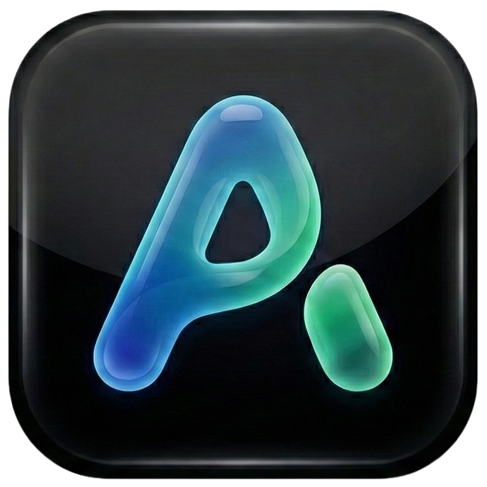

<p align="center">
  
</p>

<h1 align="center">Anti-Power</h1>

<p align="center">
  <a href="https://github.com/mikessslxxx/anti-power/releases"></a>
  
  
</p>

<p align="center">
  <a href="README.md">中文</a> | English
</p>

> Browse and clean local **Antigravity App** and **Antigravity CLI** (`agy`) sessions, and install Usage Monitor.

## Features

- Lists sessions from the Antigravity App (`~/.gemini/antigravity`) and Antigravity CLI (`~/.gemini/antigravity-cli`), plus CC Switch profiles under `~/.cc-switch/agy/<profile>/antigravity-cli`
- Searches by title, project, or session ID, filters by source (with detected client versions), and views messages
- Deletes single or multiple sessions and reports the outcome for each
- Flags index-only leftovers (records left behind after another tool removes the session files) so they can be removed as well

Verified on macOS with Antigravity App 2.34.0 and Antigravity CLI 1.5.14. The Windows and Linux builds are untested. Antigravity IDE (`~/.gemini/antigravity-ide`) is not supported.

## What gets cleaned

Each deletion is scoped to a single source and session ID. After cleanup, tools such as CC Switch no longer list the session:

| Location | Content |
|----------|---------|
| `conversations/<id>.db` with `-wal`, `-shm`, `-journal`, and `<id>.pb` | Conversation data |
| `brain/<id>/` | Logs and artifacts |
| `annotations/<id>.pbtxt`, `presence/<id>.lock` | Annotations and presence lock |
| `conversation_summaries.db` | Summaries, full-text index, parent links |
| `agyhub_summaries_proto.pb`, `jetbox_summaries_proto.pb` | Summary index |
| `cache/last_conversations.json`, `cache/conversation_metadata.json` | Recent sessions and cached summaries |
| `history.jsonl` | Session entries in the Antigravity CLI prompt history |
| `sidecar_data/<plugin>/<panel>/events/*.json` | Plugin sidecar events |
| `sidecar_data/<plugin>/<panel>/logs/sidecar.log` | Log lines for the deleted session |
| `app_storage.json` in the Antigravity App data folder | Window layout and side panel state |
| `ledger.json` under `sidecar_data/anti-power-usage/` | Legacy Anti-Power Usage totals for the session, folded into "Deleted sessions" |

- Subagent conversations are removed with their parent. Sessions created by `/fork` are kept.
- The same ID can exist in both the Antigravity App and Antigravity CLI. Each is listed separately; select both to remove it from both.
- The Antigravity App data folder is `~/Library/Application Support/Antigravity` on macOS, `%APPDATA%\Antigravity` on Windows, and `~/.config/Antigravity` on Linux.
- Runtime logs (`log/`) and files written to `/tmp` or project folders are left untouched.
- Compacts `conversation_summaries.db` after cleanup to clear deleted-row fragments (deferred if another tool is reading it). Deleted files are not wiped at the disk level.

Three options at the top of the window are off by default, and the choice is remembered:

- **Antigravity App browser cache**: empties `Cache/` and `Code Cache/` in the Antigravity App data folder. They cannot be filtered by session and may hold session IDs; the Antigravity App rebuilds them, so the next launch is a little slower.
- **CC Switch sync records**: removes sync progress (`session_log_sync`) from `cc-switch.db` and `backups/*.db` under `~/.cc-switch/` for selected sessions and sessions with no trace left in their source, then compacts each database (skipping the live database while CC Switch is open; refresh after it exits to recheck). Usage and cost history contains no conversation text and is kept.
- **Usage Monitor session history**: clears cached titles and prompts for App and CLI sessions with no local copy left, keeping token and cost history. Removes the conversation entry when the installed plugin has a matching independent usage record, or leaves a redacted placeholder otherwise. Standalone Usage Monitor can stay open (local sessions are deleted immediately; refresh after it exits to finish cache cleanup).

App data, CC Switch, and Usage Monitor cleanup runs after session deletion is committed; if it fails, the session stays deleted and the result lists what was not cleaned.

Quit the Antigravity App and Antigravity CLI before deleting; cleanup is also refused while Antigravity IDE is running. Deletion cannot be undone.

If cleanup is interrupted, quit any running Antigravity clients and reopen Anti-Power or refresh the session list: Anti-Power finalizes committed deletions and restores uncommitted ones, or shows a notice above the list if recovery fails.

## Usage plugin

Use the **Usage Monitor** button in the title bar to install the latest official [Usage Monitor release](https://github.com/yuhuan-dev/antigravity-usage-monitor/releases/latest) into `~/.gemini/config/plugins/usage-monitor`, or uninstall it. Enable the plugin in Antigravity under **Customizations → Installed** to view cache hit rates and account quotas. Prices and the CLI status line are managed in Usage Monitor (if enabled, turn the CLI status line off there before uninstalling).

Installation adds two Anti-Power buttons to the official plugin: the panel header opens the current local session, and Settings opens the **Usage Monitor** dialog. The built-in ZIP updater reapplies the buttons.

On macOS, quit Antigravity and choose **Launch Antigravity with debugging** in the **Usage Monitor** dialog to use the top bar or composer overlay.

If you installed Anti-Power Usage with v5.1–5.2, uninstall it with the older version first to restore its CLI status line. Its ledger stays on disk and is not imported by Usage Monitor.

## Installation

Download an installer from [Releases](https://github.com/mikessslxxx/anti-power/releases):

- **Windows**: `anti-power-windows.exe`
- **macOS (Universal)**: `anti-power-macos-universal.dmg` (unsigned; if macOS reports it is damaged, run `xattr -cr /Applications/Anti-Power.app`)
- **Linux**: `anti-power-linux.AppImage`

Running from source requires Node.js 22.12+ and Rust 1.95+:

```bash
cd patcher
npm install
npm run tauri:dev
```

## Legacy patches

Google Antigravity now renders LaTeX and Mermaid natively, so the patches were removed. [v4.0.0](https://github.com/mikessslxxx/anti-power/releases/tag/v4.0.0) is the last release that includes them and supports up to Antigravity IDE v2.0.6.

## Documentation

- Changelog: [CHANGELOG_EN.md](CHANGELOG_EN.md)
- Release guide: [release-guide.md](docs/guides/release-guide.md)

## Contributing

Issues and pull requests are welcome.

## Acknowledgments

- [@daoif](https://github.com/daoif) (original author)
- [@syanle](https://github.com/syanle)
- [@Sophomoresty](https://github.com/Sophomoresty)
- [@Wusir7355608](https://github.com/Wusir7355608)
- [@aiaiads](https://github.com/aiaiads)

## License

[GPL-3.0](LICENSE). v5.0.1 and earlier were released under the MIT License; that notice is kept in [LICENSE-MIT](LICENSE-MIT).
